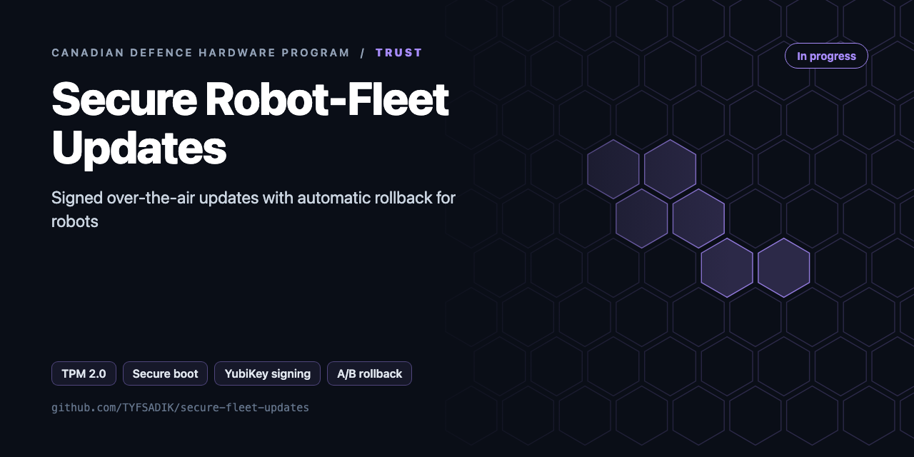
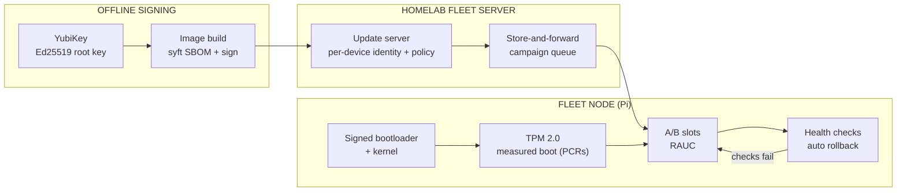

<div align="center">



# Secure Robot-Fleet Updates

**Secure boot, TPM 2.0 measured boot, YubiKey-signed over-the-air updates, and automatic A/B rollback for a small robot fleet, tested in a cold chamber.**

[](https://github.com/TYFSADIK/secure-fleet-updates/actions/workflows/tests.yml)   [](LICENSE) [](https://github.com/TYFSADIK/defence-hardware-program)

[Build guide](docs/project-page.md) · [How it works](#how-it-works) · [Quick start](#quick-start) · [Program hub](https://github.com/TYFSADIK/defence-hardware-program)

</div>

## Overview

The Army's **MINERVA challenges** say it plainly: Canada has bought foreign robotic systems of mixed quality, with components from unstable supply chains. The **Defence Drone Initiative (launched July 23, 2026)** makes supply-chain integrity a theme rather than an afterthought. A drone or ground robot that will accept any firmware image anyone hands it is a liability, no matter how good its sensors are.

This build connects my DevOps discipline to hardware. The fleet is small, the Raspberry Pi nodes from my rover and sensor builds, but the rules are the ones a real program needs:

And because these robots are meant to operate in the cold, the same cold the MINERVA documents complain about, the whole update-and-rollback cycle gets validated in a freezer, not just on a warm bench.

## How it works



*Images are signed by a key that never touches a network, delivered through a store-and-forward campaign queue, and installed into the inactive A/B slot, health checks decide whether the new slot stays or the node rolls back.*

## Quick start

```bash
make test     # happy path, auto-rollback, forged key, swapped image, downgrade, campaign halt, PCR mismatch
make build    # includes linux/arm64 for the Pi
```

## What's in this repo

| Path | Purpose |
|---|---|
| `ota/agent.go` | A/B agent: signature check against a pinned key, device-class check, **anti-rollback floor**, digest and size check, atomic state file, trial boots, `Confirm()` |
| `campaign/campaign.go` | Wave rollout (canary 5%, then 25%, 50%, all) that halts automatically if a wave's rollback ratio is too high. Unreachable robots don't count as failures |
| `measured/pcr.go` | Parses `tpm2_pcrread` and compares against golden PCRs 0, 2, 4, 7 |
| `cmd/fleet-ota` | Device CLI: `status`, `stage`, `boot`, `confirm`, `pcr` |
| `scripts/` | YubiKey signing notes, systemd health-confirm unit |

## What you need

| Category | Item | Notes |
|----|----|----|
| Hardware | TPM 2.0 add-on board | SLB9670-class for the Pi; enumerate with the correct dtoverlay before blaming the chip |
| Hardware | 2 YubiKeys | Offline Ed25519 signing keys, one as backup; never on a networked machine |
| Hardware | Raspberry Pi fleet nodes | Shared with the rover and sensor builds |
| Hardware | Cold chamber | Chest freezer shared with the cold-soak rig, or a Canadian winter; sealed-bag discipline for condensation |
| Software | tpm2-tools, cryptsetup/LUKS | Measured boot, PCR policy, sealed keyslots plus the offline recovery keyslot |
| Software | Signing and update scripts | Image signing, verification on the node, A/B slot management, health-gate and mark-good flow |
| Software | Fleet server on the homelab | Enrolment, serial-rollout campaign policies, store-and-forward delivery rehearsal under netem |
| Skills | Linux boot process, LUKS, TPM basics | Understanding measured boot and PCR fragility, key management hygiene |
| Accounts | None | No accounts or licenses required |

## Status

- **Done**: hardware on the bench (TPM board, both YubiKeys, fleet nodes); secure-boot chain with signed bootloader and kernel; TPM enumerated and measured boot logging; LUKS keys sealed to PCRs (with an offline recovery key after the lockout lesson); basic A/B update with a health-gate script; first cold rollback runs in the freezer; mid-transfer corruption verified to reject.
- **In progress**: automated mark-good flow end to end; per-device enrolment and serial-rollout campaign policies on the homelab fleet server; store-and-forward delivery under `netem` degraded-link rehearsal; accumulating the cold-temperature test matrix (T5).
- **Next**: full power-cut chaos battery (T6) warm and cold; publish the test dataset (campaign counts, rollback rate vs temperature); conformal coating for outdoor nodes; extend enrolment to every rover and sensor node in the program.

| Test | Target | Current status |
|----|----|----|
| T1 Boot-chain rejection | 0 of 3 bad variants boot | Passing on the bench rig |
| T2 TPM seal integrity | Tampered image cannot unseal; control can; recovery key works | Passing on the bench rig |
| T3 Campaign reliability | 100% mark-good, serial order respected | In progress, accumulating runs |
| T4 Forced rollback | 100% return to last-known-good | Basic path passing; full automation in progress |
| T5 Cold matrix | Identical outcomes at room, -20 °C, warm-up | In progress, first freezer runs logged |
| T6 Fault injection | 100% signed, working state after every fault | Next, corruption path verified, power-cut battery not yet run |

## Roadmap

- [ ] Wire `fleet-ota boot` into the Pi 5 bootloader (`tryboot` + `autoboot.txt` A/B partitions) or U-Boot `bootcount`
- [ ] Mirror `MinVersion` into a TPM NV monotonic counter so it survives an SD card swap
- [ ] Seal the fleet mTLS key with `tpm2_create --policy pcr:sha256:0,2,4,7` so it unseals only on a golden boot
- [ ] Deliver images through `ddil-proof-devops` delta chunks
- [ ] Cold-chamber test T3: campaign reliability at -20 °C (SD card write errors, brown-outs during write)

## Related builds

- [**Canadian Defence Hardware Program**](https://github.com/TYFSADIK/defence-hardware-program), the hub: every build, the full phased BOM, and the Canadian requirements each one answers.
- [**Zero-Trust Air-Gapped Supply Chain**](https://github.com/TYFSADIK/zero-trust-air-gapped-supply-chain), the signing, SBOM, and provenance discipline this fleet inherits, proven on containers first.
- [**DDIL-Proof DevOps**](https://github.com/TYFSADIK/ddil-proof-devops), the store-and-forward delivery patterns the fleet server reuses for nodes on degraded links.
- [**Cold-Soak Characterization Rig**](https://github.com/TYFSADIK/cold-soak-battery-rig), the shared chest freezer and instrumentation behind this build's cold-chamber update tests.

## Learn more

The full build guide, with step-by-step instructions, wiring, troubleshooting and lessons learned, is in [docs/project-page.md](docs/project-page.md). It is also published at [tyfsadik.org](https://tyfsadik.org/work/defence/secure-fleet-updates.html).

## License

[MIT](LICENSE). Built by [Taki Sadik](https://tyfsadik.org) as part of the self-funded [Canadian Defence Hardware Program](https://github.com/TYFSADIK/defence-hardware-program).
