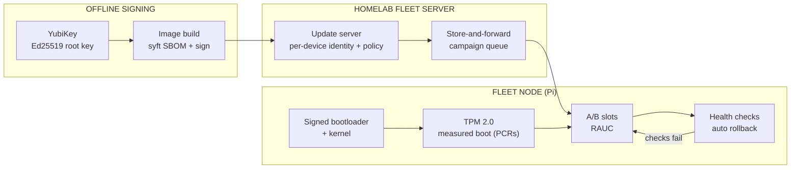
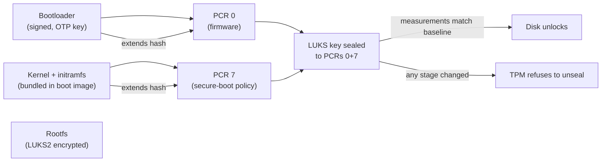

# Secure Robot-Fleet Updates

Written by [Taki Sadik](https://tyfsadik.org/about.html) · Last updated 2026-10-22 · Status: Building · 29 min read

Every node in my fleet boots only signed code, accepts only updates signed by an offline key, and rolls a bad update back automatically, then I prove it in a freezer, because that is where Canadian robots actually work.

## Overview

The Army's **MINERVA challenges** say it plainly: Canada has bought foreign robotic systems of mixed quality, with components from unstable supply chains. The **Defence Drone Initiative (launched July 23, 2026)** makes supply-chain integrity a theme rather than an afterthought. A drone or ground robot that will accept any firmware image anyone hands it is a liability, no matter how good its sensors are.

This build connects my DevOps discipline to hardware. The fleet is small, the Raspberry Pi nodes from my rover and sensor builds, but the rules are the ones a real program needs:

- **Every device boots only signed code**, a secure-boot chain from the bootloader up, with a TPM 2.0 measuring each stage and holding the disk keys hostage to that measurement.
- **Every update is signed by an offline key**, Ed25519 keys that live on YubiKeys, not on any machine connected to a network.
- **A bad update rolls itself back**, A/B partitions with health checks, so a broken image never strands a node in the field.

And because these robots are meant to operate in the cold, the same cold the MINERVA documents complain about, the whole update-and-rollback cycle gets validated in a freezer, not just on a warm bench.

## Bill of Materials

Everything below is already purchased and on my bench. The fleet nodes themselves are shared with the rover and sensor builds, so the incremental cost of making the whole fleet trustworthy is essentially the TPM and the keys.

| Item | What I used | Est. US\$ |
|----|----|----|
| TPM | TPM 2.0 add-on board for the Pi | 25-40 |
| Signing keys | 2 YubiKeys (one as backup) | 100-110 |
| Targets | Raspberry Pi fleet nodes from the rover/sensor builds | (shared) |
| Cold chamber | Canadian winter (free) or chest freezer (shared with the cold-soak rig) | 0-300 |

## Architecture

Figure 1: images are signed by a key that never touches a network, delivered through a store-and-forward campaign queue, and installed into the inactive A/B slot, health checks decide whether the new slot stays or the node rolls back.

Two trust chains meet here. The **boot chain** (signed bootloader, signed kernel, TPM measurement) guarantees the node runs only what I signed. The **update chain** (offline signing, per-device policy, A/B slots with automatic fallback) guarantees I can change what it runs without ever being able to brick it. A node that misses a campaign because its link is down simply picks the bundle up when the link returns, the same DDIL store-and-forward pattern as my field nodes.

## Measured Boot vs Secure Boot

Steps 01 through 04 implement two different ideas that are easy to conflate. Secure boot is a **gate**: the bootloader checks signatures and refuses to execute anything unsigned, so bad code never runs. Measured boot is a **record**: each boot stage hashes the next and extends the hash into a TPM Platform Configuration Register (PCR), so at the end the TPM holds a fingerprint of exactly what booted, and the disk keys are sealed to that fingerprint. Tamper with the image and the PCRs change; the TPM then refuses to unseal, and the attacker gets a brick, not the data.

**Figure 2:** the measured-boot chain: each boot stage extends a PCR, and the LUKS disk key is sealed to PCRs 0+7. A modified initramfs changes the measurements, the seal policy fails, and the disk stays locked. This is the mechanism T2 exercises.

### Why both are needed

Secure boot alone can refuse a tampered image, but it tells you nothing about what actually ran, and a keyed attacker with a valid signature could boot an older, vulnerable image. Measured boot alone cannot stop anything; it only records. Together they close both gaps: the signature check decides whether code may run, and the PCR chain decides whether the disk keys may be released, so even a validly-signed-but-old image cannot unlock data sealed to the current measurements. The recovery passphrase in a separate LUKS keyslot (step 04) is the escape hatch for when the measurements change legitimately, as any kernel update does.

### Why the signing key never leaves the card

The Ed25519 fleet root key is generated *on* the YubiKey with `gpg --edit-card`, admin PIN, and `generate`. On-card generation means the private key material never exists on any disk, it physically cannot be exported, so there is no backup file to steal and no laptop image that can leak it. Answering "no" to the "off-card backup of encryption key" prompt keeps even that option closed for the signing slot. The RAUC bundles in step 07 are signed with a second on-card key in the YubiKey's PIV slot (generated with yubico-piv-tool, accessed via the pkcs11: URI) rather than the OpenPGP key, because cosign and RAUC speak PKCS#11 and cannot reach the OpenPGP application: two applications on the same card, two keys, same never-leaves-the-card property. One firmware note: Ed25519 in the PIV slot needs YubiKey firmware 5.7 or later; older cards do the same job in the PIV slot with RSA-2048 or P-256, reached through the same pkcs11: URI. The cost of this property is real: if the card is lost, the key is gone, which is exactly why the second YubiKey holds a backup key generated the same way, stored separately and offline. The pipeline verifies with the exported public key only, the proof that verification needs nothing secret.

## Test Status

A quick visual of where the six tests stand, drawn straight from the targets table below. This is a status snapshot, not results: "passing" means the mechanism fires correctly on the bench rig (T1, T2), not that the run counts are statistically meaningful. Full numbers land only when the campaign, rollback, cold-matrix, and chaos batteries have accumulated enough runs.

## Wiring & Connections

The hardware side of this build is deliberately boring, most of the security lives in software. What is physically connected, and why:

| From | To | Cable or interface | Notes |
|----|----|----|----|
| TPM 2.0 module (Infineon SLB9670) | Pi 5 GPIO header | SPI0: MOSI/MISO/SCLK on GPIO 9/10/11, CE0 on GPIO 8, 3.3 V + GND | Module seats directly on the header; keep leads short so the SPI clock stays clean |
| Pi 5 UART (GPIO 14/15) | Bench laptop | 3.3 V USB-UART adapter | The only way to see early-boot failures when secure boot refuses an image and the screen stays black |
| DS18B20 temperature probe | Pi 5 GPIO 4 (1-Wire) | 3-wire lead, 4.7 kΩ pull-up to 3.3 V | Logs freezer temperature next to update logs; shared with the cold-soak rig |
| Wi-Fi smart plug | Pi 27 W USB-C supply | Mains side | The chaos-test power switch: cuts the node at random offsets mid-flash |
| Oscilloscope probes | SPI lines (SCLK, MOSI, MISO, CS) | Scope probes + ground clips | Used while bringing up the TPM overlay to confirm clock and traffic; visible on the bench |
| Fleet server (homelab) | Fleet nodes | Ethernet on the bench, Wi-Fi in the field | Campaigns over TLS; nodes resume partial downloads when the link drops |
| YubiKey (root signing key) | Offline signing laptop | USB | Never plugged into a networked machine; signed bundles cross to the server on removable media |

## How I Built It

### Step 01: Secure boot chain on the Pi

The foundation is Raspberry Pi secure boot: the EEPROM bootloader signature-checks the boot image, which bundles the kernel, initramfs, and device tree, so nothing unsigned ever executes. I generated an RSA-2048 device key on the offline signing machine, hashed the public key into the Pi's one-time-programmable (OTP) memory, and set `SIGNED_BOOT=1` in the EEPROM config. From that moment the board is a device that will only boot my code.

**Key generation and signing (offline machine)**

    # device key lives on the offline machine only
    openssl genrsa 2048 > device-private.pem
    openssl rsa -in device-private.pem -pubout > device-public.pem

    # boot.sig = raw binary RSA-2048 signature over sha256(boot.img), not hex
    openssl dgst -sign device-private.pem -keyform PEM -sha256 \
      -out boot.sig work/boot.img

    # EEPROM config enforcing signed boot
    grep SIGNED_BOOT boot.conf
    #   SIGNED_BOOT=1

    # flash EEPROM and program the pubkey hash into OTP - ONE WAY, no undo
    cd usbboot && sudo ./rpiboot -d secure-boot-msd

What can go wrong: OTP programming is irreversible, so I rehearsed the whole sign-and-boot cycle on a second, un-programmed Pi before burning anything. I verified enforcement by deleting `boot.sig` from the boot partition and confirming over the serial console that the board refused to boot.

Two things the listing above simplifies. First, `boot.sig` is the raw binary RSA signature, not hex output; the official reference flow is the secure-boot-example scripts in Raspberry Pi's usbboot repository, including the `rpi-eeprom-digest` helper, which produce the same bytes. Second, this is the Pi 4 flow used on this build: Pi 5 secure boot additionally requires Raspberry Pi's own signature on the bootloader firmware, countersigned by the customer key, so this exact script is not portable to Pi 5.

### Step 02: Wire up the TPM 2.0 module

The TPM 2.0 board (Infineon SLB9670 class) rides the Pi's SPI header. The kernel needs SPI enabled plus the right device-tree overlay; get the overlay name wrong and the chip simply never appears, which is exactly what happened to me at first (see Troubleshooting).

**Enable the tpm and confirm enumeration**

    # /boot/firmware/config.txt
    dtparam=spi=on
    dtoverlay=tpm-slb9670

    # after reboot, the kernel should bind the driver
    dmesg | grep -i tpm
    #   tpm_tis_spi spi0.0: 2.0 TPM (device-id 0x1B, rev-id 22)
    ls -l /dev/tpm0 /dev/tpmrm0
    sudo tpm2_getcap properties-fixed | head -5

How I verified: `tpm2_getcap properties-fixed` returning the manufacturer and firmware revision proves real two-way communication, not just a device node. When the chip stayed silent, the oscilloscope on SCLK showed there was no clock at all, SPI was off, not the TPM.

### Step 03: Measured boot with PCRs

Secure boot answers "is this code signed"; measured boot answers "what exactly booted". Each boot stage extends a Platform Configuration Register, so the TPM ends up holding a hash chain of the bootloader, kernel, initramfs, and rootfs that actually ran. That chain is what the disk-encryption policy in the next step is anchored to.

**Read the measurement chain**

    # PCRs after a clean boot
    sudo tpm2_pcrread sha256:0,1,2,3,7

    # the event log: which component produced which measurement
    sudo tpm2_eventlog /sys/kernel/security/tpm0/binary_bios_measurements | less

    # baseline for comparison after updates
    sudo tpm2_pcrread sha256:0,1,2,3,7 > /etc/fleet/pcr-baseline.txt

What can go wrong: any legitimate change, a kernel update, a config edit measured into a PCR, changes the values, so the baseline file is regenerated as part of every update, not treated as permanent. I verified the mechanism by booting a deliberately modified initramfs and watching the PCRs diverge from baseline. One thing to name explicitly: the Pi's own firmware does not extend PCRs or produce this log, so the measuring stage that runs before the kernel must be documented as part of this build; without it the PCRs stay zeroed and the seal policy has nothing to anchor to.

### Step 04: Seal disk encryption keys to the TPM

The root filesystem is LUKS2-encrypted, and the volume key is sealed to the TPM's measured state. If anyone swaps in a tampered image, the PCRs change, the TPM refuses to unseal, and the attacker has a booting-but-blank brick: user data and sensor recordings stay encrypted. This is the step that turns "tampering detected" into "tampering useless".

**Luks2 + tpm sealing**

    sudo cryptsetup luksFormat --type luks2 /dev/mmcblk0p3
    sudo systemd-cryptenroll --tpm2-device=auto --tpm2-pcrs=0+7 /dev/mmcblk0p3

    # /etc/crypttab
    #   rootfs  /dev/mmcblk0p3  none  tpm2-device=auto,discard

    # confirm the TPM2 token is enrolled
    sudo cryptsetup luksDump /dev/mmcblk0p3 | grep -A3 tpm2

What can go wrong: locking myself out. A recovery passphrase sits in a separate LUKS keyslot, printed and stored offline, I needed it once already, after my own kernel update changed the measurements before the re-seal step ran. That lesson is why re-sealing is now a pipeline step, not a manual chore.

### Step 05: Signing keys on YubiKeys

Update manifests are signed with an Ed25519 key generated *on* a YubiKey, the private key never exists anywhere else and cannot be exported. The signing laptop stays offline; only signed bundles cross to the fleet server. A second YubiKey holds the backup key, generated the same way and stored separately, so losing one device cannot kill the fleet's update channel.

**On-card key generation and signing**

    # generate the key ON the card (OpenPGP application, ed25519)
    gpg --edit-card
    #   gpg/card> admin
    #   gpg/card> generate      # key type: ed25519

    # sign an update manifest; the PIN pads the card, the card signs
    gpg --detach-sign --armor --local-user FLEET-ROOT manifest.json
    gpg --verify manifest.json.asc manifest.json

How I verified: I unplugged the YubiKey mid-workflow and confirmed signing is impossible without it, then verified the signature on a different machine using only the exported public key, the proof that verification needs nothing secret.

### Step 06: SBOM and signature verification

Every image build emits an SBOM with `syft` (SPDX JSON, committed next to the image), and the bundle digest is signed offline, cosign-style. On the node, verification is a hard gate chained directly to install: anything that fails verification is deleted, never staged. This is the same pipeline discipline as my [zero-trust air-gapped supply chain](https://github.com/TYFSADIK/zero-trust-air-gapped-supply-chain) project, applied to physical devices instead of containers.

**Build-time sbom, sign, node-side verify**

    # offline build machine
    syft dir:./rootfs -o spdx-json=update-1.4.0.spdx.json
    cosign sign-blob --key "pkcs11:object=FLEET-ROOT" \
      --bundle update-1.4.0.cosign.bundle update-1.4.0.raucb

    # on the node: verify BEFORE install; && is the gate
    cosign verify-blob --key /etc/fleet/fleet-root.pub \
      --bundle update-1.4.0.cosign.bundle update-1.4.0.raucb \
      && rauc install update-1.4.0.raucb

What can go wrong: clock skew on a node that has been powered off makes signature timestamps look wrong, so verification pins the known public key rather than a time-based chain, and nodes sync time against my GNSS-disciplined clocks before checking in.

### Step 07: RAUC A/B partitions and bundles

Each node carries two rootfs slots, A and B. An update is a signed RAUC bundle that writes only to the inactive slot, so the running system is never touched mid-write, a power cut during install leaves the active slot fully intact. RAUC's keyring is the fleet's offline CA, which makes unsigned bundles fail before a single byte is written.

**/etc/rauc/system.conf and bundle build**

    [system]
    compatible=tyfsadik-fleet-node
    bootloader=custom

    [keyring]
    path=/etc/rauc/fleet-root-ca.cert.pem

    [slot.rootfs.0]
    device=/dev/mmcblk0p2
    type=ext4
    bootname=A

    [slot.rootfs.1]
    device=/dev/mmcblk0p3
    type=ext4
    bootname=B

    # offline machine: build the signed bundle
    rauc bundle --cert=fleet-rel.cert.pem \
      --key="pkcs11:object=FLEET-ROOT;type=private" \
      build/ update-1.4.0.raucb

How I verified: `rauc info update-1.4.0.raucb` on the node shows the verified signature chain, and `rauc status` shows exactly which slot is booted, which is active, and which will receive the next bundle.

### Step 08: Health-check gate and automatic rollback

After an install, the bootloader tries the new slot exactly once. A systemd one-shot health gate runs on that first boot: core services up, TPM readable, heartbeat to the fleet server established. Only a clean pass calls `rauc status mark-good`. If the mark never arrives, the bootloader's boot counter expires and the node falls back to the last-known-good slot on the next reset, no human required.

**/usr/local/sbin/fleet-health-check + systemd unit**

    #!/bin/sh
    # runs once on the first boot of a new slot
    systemctl is-active --quiet rauc fleet-heartbeat || exit 1
    tpm2_pcrread sha256:7 -Q || exit 1
    ping -c1 -W2 fleet.tyfsadik.lan >/dev/null || exit 1
    rauc status mark-good

    # fleet-health.service: Type=oneshot, After=network-online.target,
    # ExecStart=/usr/local/sbin/fleet-health-check, WantedBy=multi-user.target

What can go wrong: a health check that is too strict bricks the update path (everything rolls back forever); too loose and broken images get marked good. I tuned it against a deliberately crippled image, network service masked, and confirmed the node rolled itself back to the previous slot after the boot-count limit.

### Step 09: Fleet server: identity, policy, campaigns

The homelab fleet server knows every node by a per-device certificate issued at enrolment, a rover in active testing gets builds far more often than a deployed sensor node, and every campaign is auditable: which devices, which version, what order. Policies are serial by default: the next node waits until the previous one has marked its slot good, so a bad image can never take the whole fleet down at once.

**Campaign definition and enrolment**

    # campaign.yaml on the fleet server
    campaign: rover-fleet-2026-09
    image: update-1.4.0.raucb
    targets: [rover-01, rover-02]
    policy:
      rollout: serial        # one node at a time
      require_healthy: true  # wait for mark-good before the next node
      resume: true           # resume partial downloads

    # node-side enrolment (my small script over the fleet CA)
    sudo fleet-enrol --server https://fleet.tyfsadik.lan \
      --tpm --out /etc/fleet/device.json

How I verified: enrolling the same node twice fails, the server already has that TPM-bound identity, and a campaign scoped to `rover-01` leaves `rover-02` untouched, which is exactly the targeting guarantee I want before the fleet grows.

### Step 10: Store-and-forward delivery on degraded links

Nodes that are offline, or behind a link that drops, must not miss a campaign. Bundles queue server-side; node-side fetches are resumable and digest-checked against the signed manifest, so a half-downloaded bundle picks up where it stopped. This is the DDIL pattern from my [DDIL-proof DevOps](https://github.com/TYFSADIK/ddil-proof-devops) build, a robot on a degraded mesh and a laptop on hotel Wi-Fi are the same problem.

**Resumable fetch + bench rehearsal of a bad link**

    # node-side fetcher: resume, retry, then check against the signed digest
    curl -C - --retry 20 --retry-all-errors \
      -o update-1.4.0.raucb \
      https://fleet.tyfsadik.lan/bundles/update-1.4.0.raucb
    echo "$DIGEST  update-1.4.0.raucb" | sha256sum -c -

    # rehearse DDIL conditions on the bench
    sudo tc qdisc add dev eth0 root netem loss 15% delay 400ms
    sudo tc qdisc del dev eth0 root   # back to normal

How I verified: I pulled the Ethernet cable mid-download three times in a row under `netem` loss and confirmed the final file still matched the signed digest, resume plus verification, not luck, is what makes that safe.

### Step 11: Cold-chamber validation

The update-and-rollback cycle is tested cold, not just on the bench. The node goes into the chest freezer (shared with the cold-soak rig) and runs the full sequence at freezer temperatures around -20 °C: enrol, download, verify, install to the idle slot, trial boot, health check, mark-good, and then again with a deliberately bad image to force a cold rollback. Flash and SD cards genuinely behave differently in the cold: slower, higher error rates, occasional marginal reads. A rollback mechanism tested only at room temperature is an assumption, not a capability.

**Temperature + update state logging during a freezer run**

    while true; do
      T=$(cat /sys/bus/w1/devices/28-*/w1_slave | awk -F= '/t=/{print $2/1000}')
      echo "$(date -Is) temp=${T}C slot=$(rauc status --output-format=shell \
        | grep ^RAUC_SYSTEM_BOOTED)" >> /var/log/cold-update.log
      sleep 30
    done

What can go wrong: condensation. A node pulled from the freezer and powered up wet is a corrosion risk, so cold runs end with the node sealed in a bag while it warms to room temperature, the same discipline as never charging a cold battery.

### Step 12: Chaos tests

The final gate is deliberately breaking things: corrupt bundles mid-transfer, kill power mid-flash at random offsets with the smart plug, and feed the node well-formed bundles with invalid signatures. Each fault is injected repeatedly, warm and cold. The pass criterion is absolute: after any fault, in any order, the device returns to a signed, working state, either the new verified slot or the last-known-good one, with zero manual intervention.

**Fault injection**

    # corrupt 1 MiB in the middle of a bundle mid-transfer
    dd if=/dev/urandom of=update-1.4.0.raucb bs=1M seek=40 count=1 conv=notrunc

    # power-cut mid-flash at a random point in the write
    sleep $((RANDOM % 90))
    curl -X POST "http://plug.local/relay/0?turn=off"

    # after power returns: must show a GOOD, bootable slot
    rauc status --output-format=shell | grep -E "BOOTED|GOOD"

How I verified failure honestly: the first corruption run did exactly what it should, verification rejected the bundle and nothing was installed. A test that never fails isn't proving anything; I want to see the rejection path fire every time a fault is injected.

## Testing & Metrics

The test protocol treats trust properties as measurable, pass/fail things. Each run below has a fixed setup, procedure, and metric; results are logged per run so the eventual dataset is counts, not vibes.

### T1, Boot-chain rejection

- **Setup:** OTP-programmed node, serial console attached to catch early-boot output.
- **Procedure:** attempt to boot (a) an unsigned image, (b) an image signed with the wrong key, (c) a valid image with one byte flipped.
- **Metric:** boots accepted. Target: 0 of 3, every variant must be refused before the kernel starts.

### T2, TPM seal integrity

- **Setup:** node with LUKS rootfs, key sealed to PCRs 0+7, recovery passphrase in a separate keyslot.
- **Procedure:** boot a deliberately modified initramfs; attempt to unlock the disk. Repeat with the unmodified image as control.
- **Metric:** unseal blocked for the tampered image, unseal succeeds for the control, recovery passphrase works. Target: 3 of 3.

### T3, Update campaign reliability

- **Setup:** two enrolled nodes, fleet server running a serial-rollout campaign.
- **Procedure:** run repeated full campaigns (enrol check, transfer, verify, install, trial boot, health gate, mark-good) at room temperature.
- **Metric:** per-stage success counts across campaigns. Target: 100% mark-good on every node, serial ordering respected every time.

### T4, Forced rollback

- **Setup:** a deliberately crippled image (network service masked so the health gate can never pass).
- **Procedure:** push it as a campaign; observe trial boot, health-gate failure, boot-count expiry, fallback.
- **Metric:** campaigns ending on the last-known-good slot with no manual intervention. Target: 100%.

### T5, Cold matrix

- **Setup:** node plus DS18B20 probe in the chest freezer, logging temperature and slot state together.
- **Procedure:** run T3 and T4 at room temperature, at freezer temperature (~-20 °C), and during warm-up.
- **Metric:** success vs temperature, plus any cold-only errors (slow flash, marginal reads). Target: identical outcomes across the matrix; deviations get root-caused, not averaged away.

### T6, Fault injection (chaos)

- **Setup:** smart plug on the node's power, corruption script for mid-transfer damage, invalid-signature bundles.
- **Procedure:** inject each fault repeatedly, warm and cold: truncated bundles, flipped payload bytes, power cuts at random offsets into the flash write.
- **Metric:** returns to a signed, working state with zero manual recovery. Target: 100% across every fault type and temperature.

### Targets and current status

| Test | Target | Current status |
|----|----|----|
| T1 Boot-chain rejection | 0 of 3 bad variants boot | Passing on the bench rig |
| T2 TPM seal integrity | Tampered image cannot unseal; control can; recovery key works | Passing on the bench rig |
| T3 Campaign reliability | 100% mark-good, serial order respected | In progress, accumulating runs |
| T4 Forced rollback | 100% return to last-known-good | Basic path passing; full automation in progress |
| T5 Cold matrix | Identical outcomes at room, -20 °C, warm-up | In progress, first freezer runs logged |
| T6 Fault injection | 100% signed, working state after every fault | Next, corruption path verified, power-cut battery not yet run |

Full numbers (campaign counts, rollback rates, cold-vs-warm comparison) will be published once the matrix has accumulated enough runs to mean something. Nothing above is a final result yet; "passing" means the mechanism fires correctly on the bench, not that the run count is statistically meaningful.

**Key discipline:** the root signing key lives on a YubiKey that never touches a networked machine, signing happens on an offline machine, and only signed bundles cross to the fleet server. The backup key is stored separately and offline, so losing or compromising any single device cannot produce a valid signature.

## Troubleshooting & Lessons

- **TPM never enumerated.** The module sat silently on the header with no `/dev/tpm0`. The scope showed no clock on SCLK, SPI itself was off, and my first overlay name didn't match the chip. Fix: `dtparam=spi=on` plus the correct `dtoverlay=tpm-slb9670` for the SLB9670-class board, confirmed with `dmesg | grep -i tpm`. Lesson: debug the bus before blaming the chip.
- **I locked my own node out of its disk.** A legitimate kernel update changed the PCR measurements, the TPM refused to unseal, and the node couldn't decrypt its own rootfs after a perfectly valid update. Fix: the offline recovery passphrase (separate LUKS keyslot, stored offline), and re-sealing the TPM policy is now an explicit step in the update pipeline, run with every build.
- **OTP is one-way, and I knew it could still surprise me.** Programming the secure-boot key hash into OTP cannot be undone, a mistake there turns a Pi into a paperweight. Fix: rehearsed the entire sign-flash-boot cycle three times on a second, un-programmed board first, and only burned OTP after three clean reject-and-accept cycles.
- **A cheap SD card died during power-cut rehearsals.** Random mid-flash power cuts are exactly what consumer cards hate; the card, not the update mechanism, was the weak point. Fix: high-endurance cards from the Phase 0 kit, and the A/B layout means even a failed slot write never touches the running system.
- **Condensation in the freezer.** The first cold run ended with a damp node that I was not about to power up. Fix: the node now goes into and out of the freezer in a sealed bag and warms to room temperature before power-up, the same discipline as never charging a cold battery. Conformal coating is on the list for nodes that will live outdoors.

## Status & Roadmap

- **Done**: hardware on the bench (TPM board, both YubiKeys, fleet nodes); secure-boot chain with signed bootloader and kernel; TPM enumerated and measured boot logging; LUKS keys sealed to PCRs (with an offline recovery key after the lockout lesson); basic A/B update with a health-gate script; first cold rollback runs in the freezer; mid-transfer corruption verified to reject.
- **In progress**: automated mark-good flow end to end; per-device enrolment and serial-rollout campaign policies on the homelab fleet server; store-and-forward delivery under `netem` degraded-link rehearsal; accumulating the cold-temperature test matrix (T5).
- **Next**: full power-cut chaos battery (T6) warm and cold; publish the test dataset (campaign counts, rollback rate vs temperature); conformal coating for outdoor nodes; extend enrolment to every rover and sensor node in the program.

## Related Builds

- [**Canadian Defence Hardware Program**](https://github.com/TYFSADIK/defence-hardware-program), the hub: every build, the full phased BOM, and the Canadian requirements each one answers.
- [**Zero-Trust Air-Gapped Supply Chain**](https://github.com/TYFSADIK/zero-trust-air-gapped-supply-chain), the signing, SBOM, and provenance discipline this fleet inherits, proven on containers first.
- [**DDIL-Proof DevOps**](https://github.com/TYFSADIK/ddil-proof-devops), the store-and-forward delivery patterns the fleet server reuses for nodes on degraded links.
- [**Cold-Soak Characterization Rig**](https://github.com/TYFSADIK/cold-soak-battery-rig), the shared chest freezer and instrumentation behind this build's cold-chamber update tests.

## Build Narrative: Phase by Phase

**Phase 1: TPM bringup.** An SLB9670-class TPM 2.0 add-on board on the Pi's SPI header. Bringup fought the bus, not the chip: `dtparam=spi=on` plus the correct `dtoverlay=tpm-slb9670`, confirmed with `dmesg | grep -i tpm` and `/dev/tpm0` appearing. The scope showed no clock on SCLK until the overlay matched.

**Phase 2: secure boot chain.** A signed bootloader and kernel chain from the bootloader up, with the TPM 2.0 measuring each stage. The OTP key-hash programming was rehearsed three times on a second, un-programmed board, with full reject-and-accept cycles, before being burned on the real node. OTP is one-way: a mistake there is a paperweight.

**Phase 3: sealed disk keys.** LUKS disk keys sealed to the TPM's PCR measurements so the keys are held hostage to the measured boot state, plus a separate offline recovery passphrase in its own LUKS keyslot. That recovery key exists because a legitimate kernel update once changed the PCRs and locked the node out of its own disk; re-sealing the TPM policy is now an explicit step in the update pipeline.

**Phase 4: signing ceremony.** Update images are signed with Ed25519 keys that live on two YubiKeys (one is the backup), offline, never on a networked machine. The fleet nodes verify every image against the pinned key before they will install it.

**Phase 5: A/B updates with rollback.** A/B partitions with a health-gate script and a mark-good flow: a bad image rolls itself back to the known-good slot. Mid-transfer corruption was verified to reject, and the first cold rollback runs happened in the freezer. Power-cut rehearsals exposed a weak point that was not the mechanism at all: a cheap SD card dying mid-flash, replaced with high-endurance cards from the Phase 0 kit.

## What You Need

The fleet nodes are shared with the rover and sensor builds, so the incremental cost of trust is essentially the TPM and the keys. The scarcest resource is the discipline to rehearse destructive operations on a spare board.

| Category | Item | Notes |
|----|----|----|
| Hardware | TPM 2.0 add-on board | SLB9670-class for the Pi; enumerate with the correct dtoverlay before blaming the chip |
| Hardware | 2 YubiKeys | Offline Ed25519 signing keys, one as backup; never on a networked machine |
| Hardware | Raspberry Pi fleet nodes | Shared with the rover and sensor builds |
| Hardware | Cold chamber | Chest freezer shared with the cold-soak rig, or a Canadian winter; sealed-bag discipline for condensation |
| Software | tpm2-tools, cryptsetup/LUKS | Measured boot, PCR policy, sealed keyslots plus the offline recovery keyslot |
| Software | Signing and update scripts | Image signing, verification on the node, A/B slot management, health-gate and mark-good flow |
| Software | Fleet server on the homelab | Enrolment, serial-rollout campaign policies, store-and-forward delivery rehearsal under netem |
| Skills | Linux boot process, LUKS, TPM basics | Understanding measured boot and PCR fragility, key management hygiene |
| Accounts | None | No accounts or licenses required |

## Challenges and Lessons Learned

- **The TPM never enumerated.** The module sat silently on the header with no /dev/tpm0. Lesson: debug the bus before blaming the chip, the overlay name and SPI enable were the whole problem.
- **I locked my own node out of its disk.** A legitimate kernel update changed the PCR measurements and the TPM refused to unseal. Lesson: keep an offline recovery passphrase in a separate LUKS keyslot, and make re-sealing the TPM policy an explicit step in the update pipeline.
- **OTP is one-way, and it can still surprise you.** Burning the secure-boot key hash into OTP cannot be undone. Lesson: rehearse the entire sign-flash-boot cycle three times on a spare board, and only burn OTP after clean reject-and-accept cycles.
- **A cheap SD card died during power-cut rehearsals.** Random mid-flash power cuts are exactly what consumer cards hate. Lesson: high-endurance cards, and the A/B layout means a failed slot write never touches the running system.
- **Condensation in the freezer.** The first cold run ended with a damp node I would not power up. Lesson: sealed-bag discipline in and out of the cold, warm to room temperature before power-up; conformal coating is on the list for outdoor nodes.

## What Is Next

- Automated mark-good flow end to end, removing the manual step from the update pipeline.
- Per-device enrolment and serial-rollout campaign policies on the homelab fleet server.
- Store-and-forward update delivery under netem degraded-link rehearsal, because field nodes update over bad links.
- Complete the cold-temperature test matrix (T5) and run the full power-cut chaos battery warm and cold (T6).
- Publish the test dataset: campaign counts and rollback rate versus temperature.
- Conformal coating for outdoor nodes, then extend enrolment to every rover and sensor node in the program.

## Frequently Asked Questions

The module sat silently on the header with no /dev/tpm0. The scope showed no clock on SCLK, SPI itself was off, and my first overlay name didn't match the chip. Fix: dtparam=spi=on plus the correct dtoverlay=tpm-slb9670 for the SLB9670-class board, confirmed with dmesg \| grep -i tpm. Lesson: debug the bus before blaming the chip.

A legitimate kernel update changed the PCR measurements, the TPM refused to unseal, and the node couldn't decrypt its own rootfs after a perfectly valid update. Fix: the offline recovery passphrase (separate LUKS keyslot, stored offline), and re-sealing the TPM policy is now an explicit step in the update pipeline, run with every build.

Programming the secure-boot key hash into OTP cannot be undone, a mistake there turns a Pi into a paperweight. Fix: rehearsed the entire sign-flash-boot cycle three times on a second, un-programmed board first, and only burned OTP after three clean reject-and-accept cycles.

Random mid-flash power cuts are exactly what consumer cards hate; the card, not the update mechanism, was the weak point. Fix: high-endurance cards from the Phase 0 kit, and the A/B layout means even a failed slot write never touches the running system.

The first cold run ended with a damp node that I was not about to power up. Fix: the node now goes into and out of the freezer in a sealed bag and warms to room temperature before power-up, the same discipline as never charging a cold battery. Conformal coating is on the list for nodes that will live outdoors.

## Cite This Page

**Plain text**

    Taki Sadik, "Secure Robot-Fleet Updates", TYFSADIK, https://github.com/TYFSADIK/secure-fleet-updates (accessed 2026-10-22).

**BibTeX**

    @misc{sadik-secure-fleet-updates,
      author  = {Sadik, MD. Taki Yasir Faraji},
      title   = {Secure Robot-Fleet Updates},
      year    = {2026},
      url     = {https://github.com/TYFSADIK/secure-fleet-updates},
      urldate = {2026-10-22}
    }

**APA**

    Sadik, M. T. Y. F. (2026). Secure Robot-Fleet Updates. TYFSADIK. https://github.com/TYFSADIK/secure-fleet-updates

---

Original page: <https://github.com/TYFSADIK/secure-fleet-updates>
